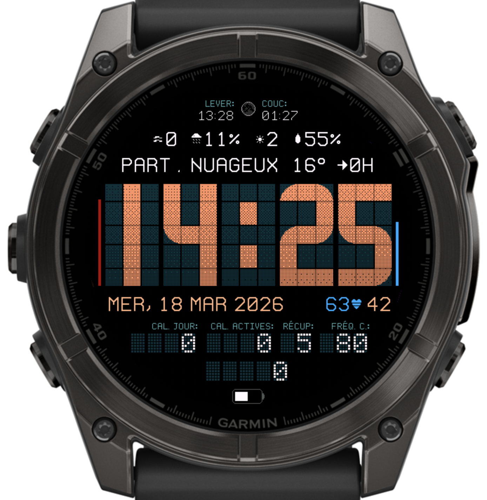
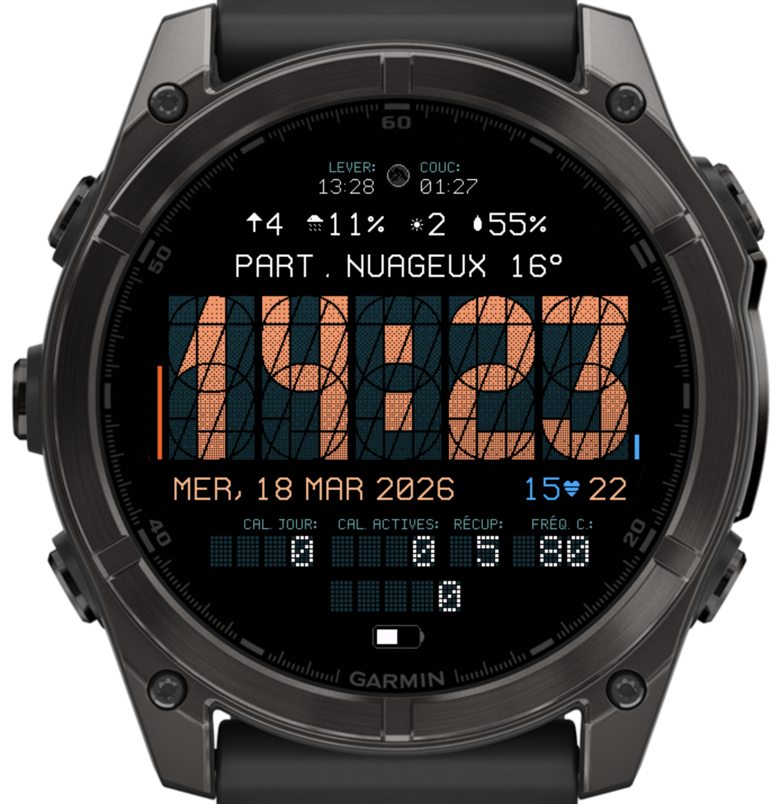

# Segment34Plus

A watchface for Garmin watches with a 34-segment display, forked from [Segment34 MkII](https://github.com/ludw/Segment34mkII) after [PR #76](https://github.com/ludw/Segment34mkII/pull/76) was rejected.

| Forecast Cycling | Alternate Layout |
| --- | --- |
|  |  |

## Features

- Time displayed with a 34-segment display
- Phase of the moon with graphic display
- Heartrate or Respiration rate
- Weather (conditions, temperature, windspeed, precipitation, UV index, humidity)
- Wind / Daily feels-like range / UV / Humidity combo line with icons
- Cycling hazard forecast with start/end hours and colors for each day
- Sunrise / Sunset
- Date
- Notification count
- Configurable: Active minutes / Distance / Floors / Time to Recovery / VO2 Max
- Configurable: Steps / Calories / Distance
- Battery days remaining (or percentage on some watches)
- Always-on mode
- Settings in the Garmin app

## Differences from upstream Segment34 MkII

Compared with `upstream/main` on 2026-03-18.

### Added in this fork

- **More weather-focused line presets**: `Wind / Precipitation / UV`, `Wind / Daily Feels-like Range / UV / Humidity`, and a cycling hazard forecast with start/end hours
- **Generic Open-Meteo weather provider option**: keep Garmin Weather or switch to `Open-Meteo`, fetched in a background service and normalized for the existing weather layouts
- **Extra presentation options**: a `4, 4, 2, 3` bottom layout, right-aligned bottom labels, and a `°`-only temperature unit
- **More uses for the notification slot**: it can show heart rate or resting heart rate
- **Visual tweaks not in upstream**: a `Peachy Orange on turquoise` theme, LED-style icon redraws, a humidity icon, and `ALT (M)` / `ALT (FT)` labels
- **Different defaults** tuned around the fork's weather-first layout

### Not carried over from current upstream

- **Custom color themes** and the upstream online theme-designer workflow
- **Night-theme features**: a separate night theme, scheduled switching, and tap-to-toggle night mode
- **Histogram mode** for the top section
- **Alternative timezone fields**
- **Clock display options** added upstream: gradient controls, outline-only mode, and AM/PM display
- **Update-frequency control**
- **The upstream distance simplification**: one shared distance-unit setting for all distance fields
- **Upstream's per-sport rolling distance fields** for run distance and bike distance over the last 7 days
- **Upstream's broader zero-notification hiding**, which is more consistent across placements

### Technical notes

- **Forecast cycling came with hard memory tradeoffs**: to stay within Connect IQ class-member limits on older MIP watches, this fork bit-packs many settings and drops some upstream features, most notably histogram and alternative timezone support
- **Rendering work is reduced** through cached system/weather reads, cached strings, cached weather resource IDs, cached sensor lookups, and cached field-width calculations
- **Font and bitmap resources are split by screen size**, which keeps the per-device binaries smaller than the shared-resource approach in upstream

## FAQ

https://github.com/Rubilmax/Segment34Plus/blob/main/FAQ.md

## Weather Providers

`Open-Meteo` is the default provider. You can switch back to `Garmin Weather` in the watch face settings.

`Open-Meteo` uses Open-Meteo's `/v1/forecast` endpoint with automatic best-model selection for the current location. It keeps the existing weather fields and forecast cycling while letting Open-Meteo choose the most suitable forecast model behind the scenes.

The Open-Meteo provider uses automatic location only. The watch face resolves the current position from the device when available, then falls back to Garmin Weather's current observation location when that is available. If a refresh fails for any reason, the last saved Open-Meteo forecast remains on screen until a newer refresh succeeds or the normal 18-hour cache window expires.

Attribution: weather data for the custom provider is delivered by Open-Meteo using its automatic best-model selection across supported forecast models.

### Daily feels-like range and hazard forecast

The default weather combo shows today's full-day feels-like minimum and maximum as a two-thirds-filled thermometer followed by `MIN-MAX°`. Values use your selected Celsius or Fahrenheit setting. This range is available with Open-Meteo; it is omitted when unavailable or when its date has passed. Other precipitation presets retain precipitation chance.

The cycling forecast shows rain/drizzle, storms, snow/mix, ice, hail, fog, wind and airborne hazards reported by the provider. Ordinary weather, haze, mist and unknown conditions do not get cycle slots. Matching hazard families merge across a single hour of ordinary weather; missing data and longer gaps keep windows separate.

Each hazard window appears for four seconds as `RAIN 10-15H`, with 24-hour local times without leading zeros. Overnight windows stay together, such as `RAIN 22-3H`. The starting day sets the color: white today, light peach tomorrow, peach the following day, then peach-orange. The line is blank when no hazards are forecast.

Open-Meteo retains up to 72 rolling forecast hours, or 36 hours on watches with a 32KB background heap or a 96KB watchface budget. Background payload limits can shorten this further. Garmin Weather uses the hourly forecast it supplies. Only the first eight Open-Meteo hours retain detailed values; the full window retains weather conditions. Wind hazards rely on condition codes, without additional speed thresholds.

## Development checks

Run `make test` to compile and run weather regression tests in the Connect IQ simulator. `make sim` builds the default fēnix 8 47mm simulator executable.

## IQ Store Listing

https://apps.garmin.com/apps/e8964cd6-53da-4004-aa03-1566c5d577e4
